# Adaptive point queries

Nearby fire buffers often query the same building tile. Decoding that tile once avoids
repeated I/O, but each query can still inspect every point to find its envelope. A
temporary longitude index reduces those repeated scans when at least eight queries
share a tile. The index changes which points need inspection; exact polygon containment
still decides which occurrences count.

## Contract and context

The [compact point store](compact-point-storage.md) retains signed int32 longitude and
latitude pairs in units of 1e-5 degrees. Its source format, quantization, tile assignment,
and Zstd payloads stay unchanged. Queries receive the same ordered list of WGS84
geometries and return one integer count per input geometry. Missing and empty geometry
or a missing database yield zero counts in their original positions.

Envelope bounds are inclusive in the existing encoded integer coordinates. Every
duplicate point remains a separate occurrence. The final Shapely containment predicate
excludes polygon boundaries and holes. The index never writes to the source database
or changes a decoded tile's coordinate array.

The sorted index is local to one tile during one query invocation. It is discarded
before the next tile is decoded. There is no persistent index, cache key, invalidation
protocol, or exception to forced recomputation.

## Complexity assessment

| Dimension | Score | Reason |
| --- | ---: | --- |
| History and state | 1 | One temporary index is shared by the current tile's queries. |
| Rule interaction | 1 | Query count selects an equivalent filtering strategy. |
| Mathematical reasoning | 2 | Inclusive integer filtering precedes strict floating-point containment. |
| Scale and representation | 2 | Sorting and contiguous coordinates amortize repeated tile scans. |
| Failure and concurrency | 1 | Read-only database access and temporary arrays have local lifetimes. |

The total is 7, an involved algorithm. The threshold is a performance heuristic; it
does not determine which points qualify and makes no optimality guarantee.

## Approach and invariants

The point store already groups queries by tile. Tiles with fewer than eight queries use
the original four coordinate comparisons. For a tile shared by at least eight queries,
`LongitudeIndex.build` copies the points in numeric longitude order and retains their
longitudes in a contiguous int64 array. Contiguous storage avoids a strided-array copy
inside each binary search. Int64 preserves every signed int32 coordinate exactly.

For a query envelope, the first search finds the first longitude greater than or equal
to the minimum. The second finds the first longitude strictly greater than the maximum.
The half-open array slice between those positions therefore includes every occurrence
at either geographic endpoint. A latitude mask removes points outside the other two
inclusive bounds. Only those candidates reach the unchanged exact containment test.

The array slice includes both copies of -1 and both copies of 1. Using a left-side
search for the upper endpoint would drop both copies of 1 and could undercount points.
Latitude filtering and strict geometry containment still apply to every retained row.

The preservation argument has three parts:

1. Sorting permutes occurrences. It cannot remove duplicates or introduce new points.
2. In a sorted array, the longitude window contains exactly the points satisfying both
   longitude bounds. Applying the latitude bounds gives the same candidate multiset as
   all four comparisons on the original tile.
3. The unchanged containment predicate tests the same decoded coordinates. Summing its
   Boolean results is independent of candidate order and retains point multiplicity.

Counts are accumulated into each query's original list position. Candidate order may
change within a tile; output count order cannot change. The existing tile enumerator's
completeness and uniqueness ensure that no point is skipped or counted twice merely
because multiple tiles are involved.

## Boundaries and failures

Empty tiles, envelopes outside the tile, and reversed bounds select no points. Negative
coordinates and signed int32 endpoints remain exact through sorting and search. An
envelope touching a point retains it as a candidate even if the final polygon predicate
rejects it as a boundary point.

The helper's domain is a decoded `(n, 2)` int32 tile and encoded integer envelope. It
does not validate arbitrary array schemas, repair invalid geometries, change coordinate
rounding, or replace GEOS's numerical behavior. Source arrays remain untouched; owned
index arrays are marked read-only, and selection returns a separate filtered array.

The existing database `finally` closes the connection on failures. The existing exact
test `finally` destroys a prepared geometry even when containment raises. Allocation or
selection errors propagate without publishing counts or modifying the source. There
are no new worker threads or durable effects.

## Costs and limitations

For a tile with `n` points and `q` queries, direct envelope filtering takes `O(qn)`
coordinate work. The indexed path takes `O(n log n)` sorting plus `O(q log n + w)`
selection, where `w` is the sum of the longitude-window lengths. Exact containment
cost is unchanged. The threshold avoids the sort for lightly reused tiles, but a query
count alone cannot predict every workload's best choice.

The index uses `O(n)` additional memory: a copied point array, contiguous longitudes,
and the sort's temporary permutation. Memory depends on the largest decoded tile;
there is no fixed byte cap. No persistent disk space is consumed.

A profiling probe using 8,530 unique actual fire buffers reduced warm query time from
5.042 to 2.930 seconds, including 0.606 seconds of index construction. Both variants
returned the same complete count list. These component measurements support the
threshold choice on that workload; they do not promise a universal speedup or a
whole-pipeline memory reduction. A persistent spatial index could reduce repeated
construction, but would introduce source-generation and storage-lifetime obligations
that this transient index does not need.

## Implementation and verification

- [point_index.LongitudeIndex](../../src/spatial_data/point_index.py) owns sorting and
  candidate selection.
- [point_store.point_counts_within](../../src/spatial_data/point_store.py) selects the
  filtering strategy and retains exact containment, query order, and cleanup.
- [PointWindow.lean](../../tests/formal/lean/PeriScribe/PointWindow.lean) proves that a
  sorted drop/take window equals inclusive filtering, that selection preserves bags,
  and that every exact predicate receives the same count. Its executable reference
  establishes the sorting premises with Lean's verified merge sort.
- [Formal conformance](../../tests/formal/conformance/test_point_index.py) compares
  NumPy selection with that executable reference across all 7,371 bags and envelopes
  in a three-by-three signed coordinate grid with zero through two point occurrences.
  [Existing spatial conformance](../../tests/formal/conformance/test_spatial_index.py)
  checks actual stored points and strict geographic containment against the tile model.
- [Helper tests](../../tests/tests/standard/spatial_data/test_point_index.py) cover
  duplicate endpoints, signed limits, ownership, empty tiles, and reversed bounds.
  [Integrated tests](../../tests/tests/standard/spatial_data/test_point_store_adaptive.py)
  exercise both strategies, holes, query ordering, source byte identity, and failure
  cleanup.

The proof covers arbitrary integer coordinates and point bags. It does not prove
NumPy's sorting or binary search, Shapely containment, floating-point geometry, or
SQLite behavior. Conformance connects the concrete adapters to the proved selection
contract for the recorded finite cases. The
[formal mapping](../../tests/formal/lean/point_window.md) records these boundaries.
