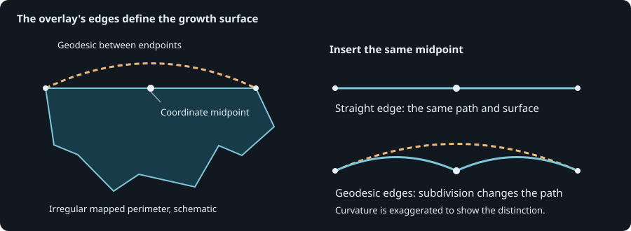

# Growth geometry precision and surface area

## Contract and context

Growth represents newly covered polygonal ground in the exact ordered display sequence.
The [corrected-history policy](corrected-growth-rings.md) determines that sequence and
its metadata. This note defines the numerical geometry and measurement used by that
policy. Full-history measurements, current acreage, source selection, and scoring retain
their separate [geodesic measurement contract](spatial-queries-and-measurements.md).

Growth overlays use one fixed longitude/latitude grid, `2^-30` degrees, and retain only
polygonal results. Growth area measures the WGS84 surface enclosed by those straight
coordinate-plane boundaries. Points and lines contribute zero. The same measure supplies
corrected footprint acreage, individual ring acreage, the strict one-square-meter ring
visibility test, and cumulative displayed additions.

Inputs are valid polygonal WGS84 geometries, or collections whose polygonal members can
be unioned. Longitude/latitude are the coordinates used by the history overlays. The
measurement does not independently reinterpret an edge crossing the antimeridian. A
short crossing must be represented by parts split at that boundary; an unsplit edge from
-179 to 179 degrees denotes the long straight coordinate-plane segment. The area formula
supports all latitudes, including Alaska and the poles, without a regional map
projection.

## Complexity assessment

| Dimension | Score | Reason |
| --- | --- | --- |
| History and state | 3 | Later corrections revise earlier rings and their cumulative display measurements. |
| Rule interaction | 2 | Grid normalization, collapsed geometry, visibility, and the cumulative baseline interact. |
| Mathematical reasoning | 3 | Snap rounding and a stable ellipsoidal surface integral require numerical arguments. |
| Scale and representation | 3 | Bounded quadrature batches must preserve each ring's contribution order and nested sums. |
| Failure and concurrency | 1 | Geometry errors propagate before the existing geography publication completes. |

**Complex, total 12.** Published growth values and ring visibility make the numerical
contract important independently of this score. The formal design was checked before
implementation; its numerical-library assumptions remain explicit below.

## One precision model for every growth overlay

Floating GEOS overlay can retry after a noding exception with heuristic snapping. In the
saved 0432 case, that path returns a valid polygon that fills a pre-existing
312,286.31-square-meter hole. A point outside both operands is inside the result, and
exact rational coordinate area exceeds the sum of the two input areas. Validity alone
does not establish that an overlay returned the intended set.

Normalize source footprints to one binary grid before the backward correction pass. Use
that grid explicitly for every intersection, difference, polygon union, and cumulative
displayed union. Extract polygonal members recursively and dissolve them within the same
precision model. Remove empty or collapsed lower-dimensional results. A mixed
collection's line coordinates therefore cannot become polygon inputs during a later
overlay.

The grid is exactly representable in binary64. At longitude magnitudes up to 180
degrees, its integer coordinate indices use about 38 bits, leaving room below binary64's
53-bit significand. It also stays within GEOS's documented recommendation of roughly 13
significant decimal coordinate digits for fixed-precision snap rounding. [GEOS overlay
documentation][overlay] and [Shapely precision reduction][precision] describe the
underlying numerical contract.

Nearest-grid rounding moves each input coordinate by at most half a grid interval. The
two-dimensional input vertex displacement is at most about **0.074 millimeters** on
WGS84, using the maximum meridional scale as a conservative degree conversion. This is
an input vertex rounding bound, not a whole-boundary Hausdorff guarantee. Valid-output
precision reduction can remove sub-grid spikes, islands and holes; newly noded
intersections also undergo rounding. Repeated overlays do not prove exact set partition
or nesting in the original floating coordinates.

The grid was selected after testing decimal intervals from `1e-13` through `1e-8`
degrees and the binary interval against all nine large saved union failures. Every
fixed-grid polygonal result retained the independent hole witness outside. The binary
grid also completed a replay of all 3,033 full-history rows in 1,129 fire histories
without an invalid overlay result. Those checks support this policy on the evaluated
corpus; they are not a proof that arbitrary GEOS executions refine ideal set operations.

Swapping operands, changing operation order, or repairing a valid result cannot provide
this contract. A precision grid only at the last cumulative union would also leave the
earlier correction and difference passes under a different numerical interpretation.

## Measure the surface represented by the overlay



*The same mapped vertices can describe different paths. A midpoint on a straight
longitude/latitude segment generally lies off the geodesic joining its endpoints. The
growth measure integrates the straight coordinate-plane path used by the overlay, so
inserting collinear vertices does not deliberately change the represented surface.*

Let `a` be the WGS84 semi-major radius, `f` its flattening, `e² = f(2-f)`, longitude
`lambda` and latitude `phi` in radians. The ellipsoid's longitude/latitude surface
density is:

```text
J(phi) = a² (1-e²) cos(phi) / (1-e² sin²(phi))²
```

An antiderivative with respect to latitude is:

```text
Q(phi) = a² (1-e²) / 2
         * [sin(phi)/(1-e² sin²(phi)) + atanh(e sin(phi))/e]
```

Green's theorem gives signed area `-integral Q(phi) d(lambda)` around a closed planar
ring. A straight coordinate-plane edge makes both longitude and latitude linear in its
edge parameter. Its contribution is the negative longitude difference multiplied by the
mean of `Q` along that latitude interval. Vertical edges have zero contribution.
Exterior magnitude minus hole magnitudes gives polygon area; nonoverlapping polygon
members add. Collection measurement is a sum of polygon members, so callers requiring
covered area normalize overlapping members through the geometry union first.

Unlike geodesic-edge measurement, this surface measure is additive over exact planar
partitions. A degree-collinear split divides the same line integral into two intervals.
No geometry densification or change to the stored boundary is necessary.

### Stable subtraction and quadrature

Subtract a latitude-reference primitive around each ring. Its integral around a closed
ring is zero because the signed longitude differences sum to zero. This keeps ordinary
fire contributions small enough to measure very thin slivers without subtracting two
ellipsoid-sized values.

Evaluate `Q(phi)-Q(reference)` directly. Write `u = sin(phi)`, `v = sin(reference)` and
compute their difference as `2 cos((phi+reference)/2) sin((phi-reference)/2)`. The two
primitive differences are:

```text
u/(1-e²u²) - v/(1-e²v²)
    = (u-v)(1+e²uv) / [(1-e²u²)(1-e²v²)]

atanh(eu) - atanh(ev)
    = atanh(e(u-v)/(1-e²uv))
```

Take coordinate differences in degrees before converting them to radians. Use an
eight-point Gauss-Legendre rule on numerical integration pieces spanning at most one
degree of latitude. These pieces subdivide the integral, not the geometry. Compensated
summation combines edge, hole, and polygon contributions.

Batch quadrature work across polygon rings while retaining each ring's own latitude
reference and ordered edge contributions. Numerical batches contain at most 8,192
latitude pieces, each with eight sample values. Finish one compensated sum over all
contributions to each ring, including a ring that spans several batches, then rebuild
the original polygon/hole and nested collection sums. Summing rounded batch subtotals
would introduce a different floating-point grouping. Partition-invariance tests and
bounded real-geometry comparisons check exact binary64 agreement across batch boundaries.

The latitude primitive is analytic within a one-radian complex neighborhood of real
latitude: `|e sin(z)| <= e cosh(1) < 0.127`, safely away from its singularities.
Bounding the primitive difference by `2e14` square meters there and applying Cauchy's
derivative bound to the Gauss-eight remainder bounds its mean truncation error on a
one-degree piece by approximately `5.3e-24` square meters. Multiply by the edge's
longitude width in radians for its area contribution. Binary64 coordinates, quadrature
coefficients, transcendental function evaluation and summation are outside that analytic
bound and dominate practical error.

Ordinary numerical checks compare with an independent high-precision surface series,
including slivers, holes, Alaska, Hawaii, polar and antimeridian representations. The
verification tolerance for the explicit independent-reference examples is `1e-5` square
meters plus `8e-15` relative error. Generated local partitions and subdivisions use
`1e-7` square meters plus `2e-14` relative error. These are numerical acceptance
criteria, not claims about source survey accuracy. On all 2,834 saved visible cumulative
states, eight- and sixteen-point results differed by at most `4.8e-7` square meters
before the overlay repair.

## Display sequence, caches and limits

For each displayed ring, union it with previously displayed polygonal ground under the
fixed precision model, measure that cumulative surface, and report `max(0, current -
previous)`. Always update the baseline, including after a clamped increment. Tiny or
undated omitted rings do not silently enter this display sequence. The [candidate and
metadata rules](corrected-growth-rings.md) remain separate: a candidate whose difference
collapses can still supply an attribute baseline.

The sequence digest exposes the measurement-policy identity and hashes that identity
before the length-delimited ordered WKB values. Ring selection trusts a stored area only
when its digest declares the current policy; untagged or legacy values require
measurement under the current model. A geometry-only digest cannot authenticate a
measurement produced under this policy. The fallback product-cache namespace also
identifies surface measurements. Ordinary geography reuse additionally authenticates the
source and native dependency context. A changed policy must invalidate prepared values
even when the WKB sequence happens to remain unchanged.

Emitted rows use fresh multipart polygon wrappers before measurement and hashing.
GeoPackage otherwise promotes single polygons when the layer also contains multipart
shapes, changing the WKB that downstream readers see. Fresh wrappers also discard native
precision metadata that WKB does not preserve. Consequently both preparation and reload
start from the same geometry representation and explicitly restore the common grid.

The one-square-meter visibility threshold remains strict. Values can cross it when
numerical semantics change, altering ring counts and active-window colors. Growth-only
fields and balloon additions can change while the full-history current-acreage and
scoring policy remain unchanged. An undated fallback drawing uses the same growth
measurement rather than borrowing its full perimeter's different edge measure.

## Costs and verification

For V visited vertices, fixed-precision normalization and overlays depend on the number
of intersections and generated vertices; a fixed per-fire cost is not assumed. Surface
measurement visits every polygon edge and quadrature sample. Each nonvertical edge uses
eight samples per at-most-one-degree latitude piece, with no additional geometry
vertices. Source coordinates and stored scalar contributions require O(V+S) memory for
the geometry's V vertices and S latitude pieces. Quadrature temporaries contain at most
65,536 sample values per array. Polygon/collection nesting also uses recursive stack
space.

Owners are [growth geometry](../../src/peri_scribe/geo/growth_geometry.py), [surface
measurement](../../src/spatial_data/surface_measurements.py), [differential
construction](../../src/peri_scribe/fires/differential.py), and [display
additions](../../src/peri_scribe/perimeters/progression.py). Ordinary regressions
preserve the original and minimized hole-fill operands, polygon filtering, collinear
subdivisions, overlap deduplication, cache identity and independent surface values.
Corpus evaluations and profiling evidence belong under `.cache/profiling/`, outside
replaceable production data.

`GrowthMeasurement.lean` proves polygon-only contribution filtering and cumulative
coverage properties over nonnegative weighted cells. The executable reference connects
those definitions to real-backend conformance examples. Existing `Geography` and
`DifferentialRows` proofs retain their ideal set, ordering, and metadata guarantees.
They do not prove snap rounding is exact intersection in the original coordinates, GEOS
correctness, the WGS84 integral derivation, or floating numerical error. Numerical
regressions and independent corpus certificates cover those additional boundaries for
the tested cases. Run `mise test-all` after implementation.

[overlay]: https://libgeos.org/doxygen/classgeos_1_1operation_1_1overlayng_1_1OverlayNG.html
[precision]: https://shapely.readthedocs.io/en/stable/reference/shapely.set_precision.html
