# Ordered history work and evidence lifetimes

Full and differential history compute each fire independently and deliver results in
the original fire order. Up to four geometry workers run concurrently. The shared
`concurrency.ordered_parallel_map` context admits at most 64 pending tasks and refills
on completion, even when an earlier result is still outstanding. GEOS releases the GIL
during geometry work; Python attribute conversion still competes for it.

## Contract and assessment

Inputs are an ordered iterable, an independent task function, positive worker and
pending limits, and optional nonnegative integer weights with a positive weight budget.
The coordinator iterates inputs and evaluates weights before submitting work. It does
not hydrate weighted metadata itself. Each successful result retains its original
position. Worker exceptions are delivered at their original position, so an earlier
input failure takes precedence over a later input failure regardless of completion order.

History/state scores 2 for retained submission, completion and delivery positions.
Rule interaction scores 2 for ordered failure, count/weight admission and oversized
inputs. Mathematical reasoning scores 1 for ordinary queue scheduling. Scale and
representation scores 3 because weight admission and result reconstruction determine
resource use. Failure/concurrency scores 3 because cancellation and worker settlement
must preserve the enclosing source and writer lifetimes. **Complex, total 11.**

## Admission and ordered delivery

*With two illustrated workers and two admitted tasks, task 1 can finish while task 0
is blocked. Its completion admits task 2. Results 1 and 2 wait for result 0, then all
three are delivered in input order. Worker availability and output order are separate.*

The coordinator retains a pending future-to-position map and a ready position-to-future
map. It admits until the pending count or weight limit prevents another task. When any
pending future completes, the coordinator observes it, removes its admitted weight and
stores the future at its original position. Contiguous ready positions are delivered;
an unavailable earlier position does not prevent another refill. A paused consumer also
pauses coordination: no independent dispatcher thread runs behind the iterator.

Weights cover submitted tasks until their completion is observed, including queued and
running work. A task whose weight exceeds the entire budget is admitted only with no
other pending tasks; no peer is admitted until it completes. Zero-weight tasks still
consume pending-count capacity. A single metadata item may be read ahead to determine
that it cannot yet fit; its task function has not begun. This lookahead must therefore
remain compact. A full input iterable or eager producer may itself retain more memory.

The pending map contains each submitted position exactly once. Observation transfers
that position into the ready map, and delivery removes only the next position. Induction
over these transitions establishes that no successful result is omitted, duplicated or
reordered. Independent tasks must not depend on when another result is delivered. Full
history's derivation keys are assigned by the coordinator after delivery; workers do not
read those output dictionaries. Differential workers likewise return independent rows.

## Failures, closure and publication

After observing any worker failure, the coordinator stops admitting new tasks. Earlier
submitted positions continue to completion and are delivered in order until the first
failed input position raises. Later results may already exist, but cannot replace that
earlier error. Input iteration, weight evaluation and executor submission errors abort
immediately; they are coordinator failures rather than ordered worker outcomes.

The public API is a context manager so consumer failure and early termination both
close the result iterator, cancel work that has not started, and join running workers
before returning control to the enclosing resource owner. Python cannot forcibly stop
an active thread. A worker that never returns can prevent release indefinitely; there
is no deadline guarantee. Process termination and a separately interrupted thread join
are outside this in-process guarantee. Exceptions can retain their input frames through
tracebacks until those futures and exceptions are released.

Delivery here means an in-memory result. Geography publication still occurs only after
the complete stage calculation succeeds. The existing file/signature publication
protocol rejects incomplete or mismatched generations after writer interruption. The
scheduler introduces no early file publication and cannot admit a failed partial stage.

Source execution references may be released after full history and its signature have
been published. Differential work then reads authenticated post-GDAL perimeters. Point
and incident evidence remains in full history; the differential artifact contains only
growth perimeters. Reader authentication and the post-GDAL numerical contract remain
unchanged.

## Costs and alternatives

For F tasks, P workers, pending limit B and admitted weight budget W, queue metadata for
unfinished work is O(B), plus one compact waiting input. Each task is submitted and
delivered once. Ready results can occupy O(F) entries when an early task is slow while
many later tasks finish. Their object graphs, the final output collector, source
metadata and native working sets are additional. This is not a bound on process RSS.
With weights, pending encoded input totals stay within W, except for one oversized task
admitted alone. A task function that retains raw inputs in its returned result defeats
the intended input-lifetime reduction even though admission accounting remains correct.

An ordered map replenished only by output consumption can leave workers idle behind a
slow early task. Eager submission avoids that gap but loses the pending bound. The
completion-driven queue retains ordered delivery and bounded unfinished admission.
A bounded output spool could additionally bound ready bytes, at the cost of encoding,
disk traffic and another failure protocol; it is not part of this implementation.

The saved October 2026 workload's earlier 8-task versus 64-task ordered-map experiment
took 202.80 versus 146.52 seconds with identical final output content. A subsequent
completion-driven private prototype took 132.24 seconds after the intervening cache and
ownership improvements. These are distinct single warm trials, not a combined speedup
claim or a production performance guarantee. Profiling evidence remains under
`.cache/profiling/`.

## Verification and ownership

`OrderedWorkers.tla` was checked before runtime implementation. Its safety configuration
explores three tasks, two pending slots, two workers, all weights in {0, 1, 3} under a
budget of two, every worker-failure subset, and consumer cancellation. It checks pending
and weight bounds, ordered successful delivery, the first input error, no admission
after observed failure, no delivery after closure, joining before release and
publication only after complete success. A separate conditional-liveness configuration
assumes workers start/finish and the coordinator/consumer continue enabled actions.
It establishes eventual release within those assumptions, not bounded completion time.

Concrete conformance follows complete paths in TLC's freshly exported graph. It controls
future completion order while the production scheduler makes admission and delivery
decisions, covering every finite weight/failure assignment, all six completion
priorities, and early consumer closure. Actual-thread regressions additionally check
refill behind a blocked first task, failure ordering, input failure and worker join.
The finite model does not prove arbitrary Python thread or GEOS behavior; ordinary
geography tests and complete output comparisons cover the implementation connection.

Owners are `concurrency.ordered_parallel_map`, `concurrency.ordered_results`,
`fires.history.history_layer_rows` and
`fires.differential.differential_perimeter_dataframe`. Existing `WorkerLifetime`,
`GeographyPublication` and `GeographyReaders` contracts retain the surrounding resource
and publication guarantees. Full forced comparisons must check ordered KMZ member
content, update bytes and report bytes before accepting pipeline changes.
