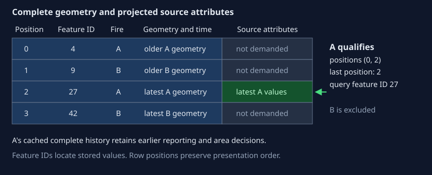

# Compact evidence for KMZ generation

KMZ generation needs complete reporting facts but only a small part of the original
source attributes. Retaining qualified histories and projecting attributes at the map's
read boundary avoids loading unrelated reporting history on an unchanged generation.
Shared immutable row views keep the remaining presentation work from rebuilding the same
perimeter objects and DataFrame slices.

## Contract and assessment

Inputs are the authenticated full/differential geography pair, complete current fire
index, area policy, inclusion threshold and preparation runtime context. Outputs are
the same qualified histories, geometry, descriptions, plots and publication contents as
complete preparation. A cache miss always permits the complete input path.

| Dimension | Score | Reason |
| --- | --- | --- |
| History and state | 1 | One invocation selects complete histories before reading map evidence. |
| Rule interaction | 3 | Generation identity, aliases, components, qualification, schema and latest-row consumers jointly permit projection. |
| Mathematical reasoning | 1 | Exact dependency hashing, indexed selection and ordered last-position demand use standard transformations. |
| Scale and representation | 3 | A compact qualified manifest and projected columns replace complete historical attribute materialization on hits. |
| Failure and concurrency | 2 | Optional cache reads can fail, while authentication, geometry reads and attribute reads must share the year lock. |

Total **10: complex**. The existing [product-cache](product-caching.md) transaction and
[geography-generation](geography-generations.md) publication protocols remain unchanged.
The new [KMZ preparation proofs](../../tests/formal/lean/kmz_preparation.md) were checked
before implementation. They cover exact dependency identity, qualification filtering,
latest-row demand and value preservation; actual-reader conformance checks connect the
definitions to GeoPackage feature IDs and schema restoration.

## Reuse complete prepared facts

The `qualified-kmz-histories-v2` product key covers both authenticated file checksums,
the complete current fire index, minimum inclusion area and the full area policy. The
product store separately supplies the code/runtime context. The file checksums include
the complete layer contents and schema, so unchanged filenames or modification times
alone cannot authorize reuse.

On a miss, read the ordinary complete layers and prepare histories through the existing
per-fire row keys. Retain complete histories whose selected historical area reaches
the inclusion threshold. Compress each canonical history payload with Zstandard before
collecting records into the outer typed product. The reader requires one complete frame
per record, then applies typed decoding, domain validation and exact reserialization to
the original uncompressed history bytes. Compression is a lossless transport adapter;
the complete-history model and persistence protocols remain unchanged.
Unknown tags, duplicate owners, malformed payloads and nonqualifying records cause a
miss. An empty qualified selection is a valid cached result.

For example, fire A has a dated historical maximum of 40 acres and fire B reaches only
10 acres. The aggregate stores A's complete history, including reports before and after
its largest perimeter. It omits B's history. Qualification still uses historical area,
so A remains showable if a later correction reduces its current area to 20 acres.

A changed geography generation misses the aggregate cache, then uses the existing
per-fire products. An incident-only correction therefore does not discard fine-grained
reuse for unrelated fires. Unconditional preparation bypasses both cache levels. When
scoring has already supplied complete layers in the execution scope, KMZ uses those
objects and shared histories directly. A present aggregate need not be reconstructed
merely to continue that shared publication.

Projection also requires the exact history key that each qualified entry will request.
Unusual legacy alias records that require additional history reconstruction stay on
the full-input path. Projected frames never enter the authoritative derived-layer
execution cache: other stages may still require all historical attributes.

The aggregate supplements the per-fire products because discovering qualification
from those products still requires every source-row fingerprint. Keeping all raw
attributes would preserve that general-purpose input at the cost of materializing
unrelated history. Loading geometry for every row keeps component, alias and plotting
selection in the existing presentation code; only the large attribute column needs
the narrower latest-row contract.

## Demand source attributes at the latest selected row

On an aggregate hit, read geometry, identifiers, measurements and observation times for
the complete perimeter, point and differential layers. Omit `source_attributes` from
the initial column read. Use the same component/alias/name row index as presentation to
select each qualified fire's rows, then demand the final position of every nonempty
selection. Fetch those source attributes by their actual feature IDs, in batches of at
most 512 IDs. The initial read explicitly uses pyogrio so its index contains feature
IDs. Restore the original column position and attribute dtype, including object dtype
and None values when a text column contains only nulls.

The four geometry rows remain available. Only A qualifies, so the map needs the source
attributes at A's last selected position, 2. Its feature ID is 27, rather than position
plus one. A's complete prepared history supplies reporting facts from its earlier row.

The latest full-perimeter and point rows supply raw description fields. The latest
point also supplies the incident complexity designation. Prepared histories supply all
area selection and reporting evolution. Charts consume that history plus complete
perimeter geometry, observation order and exterior measurements. Growth rings and
publication provenance use retained normalized columns rather than differential source
attributes. A consumer that reconstructs history must use complete attributes instead.

Empty selections demand nothing. Several fires can demand the same row. Components
remain exact; identifier aliases retain their original chronological row order; legacy
anonymous-name lookup retains its broader descriptive contract. Nonconsecutive feature
IDs, empty layers and absent attribute columns are supported. Non-text attribute schemas
use the full reader rather than coercing their scalar types into strings.

Authentication, projected layer reads and the final SQLite attribute queries all run
inside the existing year read lock. No lazy file reader, connection or deferred query
escapes that boundary. After the lock closes, consumers own all values they need. A
projection failure falls back to the full reader while the same lock remains held.
Cooperating writers cannot replace one part of the selected pair between these reads.

## Share presentation records and exact cache identities

Perimeter grouping builds identifier, name and component indexes over the same immutable
`Perimeter` objects. Equal-time component ordering preserves identifier-bucket insertion
order followed by anonymous-name buckets, matching the established selection contract.
Point indexes retain complete latest geometry per identifier inside each exact component;
an earlier alias can remain the preferred location even when a different row supplies
the latest descriptive attributes.

Plot preparation borrows just observation time, geometry and stored exterior measurement
columns. Positional views preserve repeated positions, missing values, original scalar
types and duplicate DataFrame index labels. Duplicate source column names retain the
pandas fallback. The data-access adapter keeps its involved assessment of
**1/1/1/2/0 = 5**; the surrounding identity policy remains complex as documented in
[presentation selection](presentation-selection.md).

Execution keys retain SHA-256 digests of freshly serialized index/score documents,
rather than complete large JSON strings. Fresh serialization still notices mutations
to a model's nested alias collection. Prepared histories retain validated payload
digests in their owning execution scope. The guard rechecks frozen field references,
tuple structure and one ordered typed encoding of mutable or foreign scalar children
before reusing a digest. A dictionary, quantity, unit, field or subclass change requires
a fresh identity. Full preparation retains these guards for qualifying histories;
excluded histories remain complete and acquire a freshly serialized identity if a later
consumer requests one. External histories also use the complete serializer when no
matching evidence is available. [Product caching](product-caching.md) explains these
guard boundaries.

## Costs and limits

Let B be authenticated file bytes, R retained layer rows, F indexed fires, Q qualifying
history bytes, V geometry vertices and A demanded attribute bytes. Warm standalone work
authenticates O(B) bytes, decodes O(Q) prepared facts, builds O(R) row indexes, reads the
geometry and scalar columns, and fetches O(A) attributes. It no longer fingerprints all
raw rows or decodes every nonqualifying history merely to qualify the map. Latest demand
sorting is O(F log F); each SQLite ID batch is bounded. Geometry and emitted KML remain
proportional to the evidence actually drawn, including repeated folder views.

The aggregate adds storage for compressed qualifying history payloads and one cold-build
encoding pass. Compressing each history before accumulating the outer product avoids
holding every uncompressed payload together with its expanded hexadecimal encoding.
Compression and decompression still need one complete history payload at a time. A
changed generation pays the existing full preparation cost plus that encoding; the
optimization is aimed at unchanged publication. Full layer geometry is still loaded,
and GDAL/GEOS/Arrow allocations can exceed Python-traced memory. The cache does not bound
total process RSS. Publication output staging, journal replay and source truth retain
their existing guarantees and limitations.

The cache assumes trusted product construction and SHA-256 collision resistance. It is
not an authenticated signature against a party replacing both content and its checksum.
Lean proofs do not establish third-party geometry, SQLite or pandas correctness.
Ordinary and formal conformance tests exercise exact selected values, complete output
contents, malformed-cache fallback, changed dependencies and cooperating writer locks.

## Implementation and checks

- [Prepared KMZ inputs](../../src/peri_scribe/kml/prepared_inputs.py) and
  [builder](../../src/peri_scribe/kml/builder.py).
- [Shared presentation indexes](../../src/peri_scribe/presentation/selection.py),
  [fire facts](../../src/peri_scribe/presentation/fire_data.py) and
  [plot evidence](../../src/peri_scribe/kml/plot_data.py).
- [History identity guards](../../src/peri_scribe/presentation/prepared_cache.py).
- [KMZ preparation conformance](../../tests/formal/conformance/test_kmz_preparation.py),
  [cache dependency checks](../../tests/formal/lean/cache_dependencies.md) and
  [presentation identity checks](../../tests/formal/lean/presentation.md).
