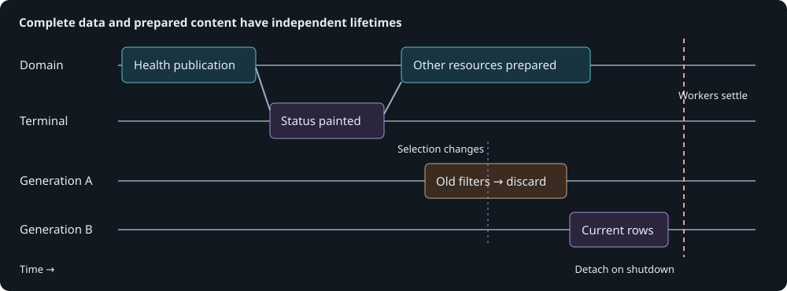

# Monitor presentation scheduling

## Contract and complexity

The terminal displays complete immutable snapshots from a domain
[session](monitor-sessions.md). The session supplies the data; the presentation layer
decides which tabs, controls, and colors to use and when the first frame is ready. It
requests domain resources using `RefreshHealth`, `RefreshRecords`, `RefreshReport`,
`LoadOlder`, and `LoadRun`.

| Dimension | Score | Reason |
| --- | --- | --- |
| History and state | 2 | User selection can refer to an older snapshot while new evidence arrives. |
| Rule interaction | 2 | First-frame gating, explicit requests, and background preparation share work. |
| Mathematical reasoning | 0 | No additional numerical algorithm. |
| Scale and representation | 2 | Formatting runs off the event loop and coalesces obsolete generations. |
| Failure and concurrency | 3 | Reader completion, shutdown, and asynchronous widget updates have different lifetimes. |

**Total 9: complex.** This note covers presentation scheduling; domain admission,
subscription, and reader ownership guarantees are defined by the session contract.

## First frame and subsequent preparation

Startup requests complete health evidence, including missing command context. The
controller formats the assessment and applies Status widgets. Only the terminal's
after-refresh callback admits background preparation of the diagnostic record stream and
report. Displaying an empty shell does not satisfy the startup target.

*The domain commits complete versions independently of the terminal. Background content
starts after Status has painted. A newer user selection invalidates generation A while
its worker finishes; only generation B is accepted for display. Shutdown detaches the
consumer before settling remaining workers.*

An early explicit request may start the requested resource before that callback; it
does not unlock all background work. Requests for the same resource share the preparation
already in flight. A queued background request can be promoted without interrupting an
admitted operation or opening a second reader. Once the initial resources are requested,
the session refreshes them on filesystem changes and periodic reconciliation.

This lets readers see a complete Status assessment while other content is still being
prepared. Preparing everything first would make Status wait for Markdown parsing and
diagnostic table creation. Waiting to prepare each view until it is selected would move
that delay to navigation. Background preparation starts after the first complete frame,
subject to available CPU and I/O. Very early navigation can still reach a view before
preparation finishes.

## Version and selection consistency

The controller accepts only increasing session versions. A complete snapshot includes
all current resources, so coalescing publications cannot lose a report update when a newer
record update arrives. The domain never waits for widgets to acknowledge publication.

Following live data replaces the visible record snapshot. Pausing preserves that
snapshot and its selected command while collection continues. Loading evidence explicitly
selects the requested command, even when its full history is outside interactive retention.
Returning to live data adopts the latest session snapshot.

Every change to records, selection, or filters increments a presentation generation.
The worker captures those inputs and prepares text, phase rows, and table rows without
mutating widgets. On completion, the controller compares generations. Obsolete results
are discarded and preparation repeats with current inputs. Applying long tables yields
periodically and checks generation and attachment again, allowing input and shutdown to
make progress. Completion is recorded only for the generation actually applied.

Each table retains its own mapping from generation-qualified row keys to evidence until
that table is replaced. A click in the other table during a batch yield still resolves
its original event; a queued click from a replaced generation cannot resolve to a new
event that happens to reuse the same sequence number.

For example, a search for `timeout` starts generation A. The user switches commands and
clears the query, creating B while A runs. Publishing A after B would replace the new
command with stale filtered rows. The generation check prevents that replacement. The
same guard applies when new live evidence supersedes a captured state.
Historical evidence focus additionally checks that the user still has the same command,
phase, and follow mode selected after preparation. Returning to live evidence while that
worker runs must not restore the earlier target's details or cursor afterward.

Markdown updates are serialized separately. A completed update records its checkpoint
only if the report still equals the latest delivered report and the terminal is attached.
A newer report causes another pass. Leaving Report does not cancel its preparation.
Cosmetic age text has a presentation-owned deadline; evidence expiry and health thresholds
remain domain policy. Moving the observation clock backward re-evaluates both layers.

## Performance charts

Performance uses the live session's compact structural history, which retains all
recent command completions after verbose diagnostic rows leave the interactive view.
Preparing the charts shares the existing presentation worker and generation check.
Paused log selection does not freeze this live history. Selecting Performance before
the first paint uses the already collected health evidence without requesting another
reader. The charts update after the first complete Status frame or an explicit request.

Both charts for an execution mode use the same successful completions within the inclusive
interval from the observation time minus 48 hours through the observation time. The
recorded elapsed duration preserves the command's monotonic timing measurement; missing
or unusable duration metadata cannot provide a sample. Completion timestamps locate
samples along the time axis. Each line chart has its own axes, with a zero-based duration
scale ending at that mode's greatest observed duration. A zero-only series uses a
one-second range. Each completion-time axis covers the same 48-hour observation window,
with labels converted to `America/Los_Angeles`, including PDT/PST changes. Quantized line
segments replace sample markers; an isolated observation remains a single horizontal
line cell.

The histogram uses that mode's observed duration range and independently scales its bars
to its largest bin count. Its interface contains only a heading, duration intervals,
bars, and bin counts. It draws no axes and does not describe the binning policy in its
labels. Terminal resizing redraws the prepared samples without reading evidence again.
The presentation clock also refreshes the time axis at least once per minute, even when
the evidence has not changed.

### Execution modes

The `run` command can collect sources, defer publication, or build selected outputs.
Grouping by command name would mix durations of substantially different work. Mode
selection reads the command's supplied parameters, latest valid selected-stage plan,
observed top-level stages, gate outcome, and recorded rebuild requirement. It gives
specific observed outcomes precedence over a broad planned build:

| Evidence, in precedence order | Series label |
| --- | --- |
| A command other than `run` | Its command name. |
| Another invocation owns the writer lock | `Skipped · another run active`. |
| Explicit stage listing | `List stages`. |
| Explicitly selected fetch stage alone | `Fetch only`. |
| Publication gate rejected further work | `Fetch only · publication deferred`. |
| Only fetch executed, with derived stages skipped | `Fetch only · unchanged`. |
| Only fetch executed, without a more specific outcome | `Fetch only`. |
| Derived work with an explicit or recorded unconditional rebuild | `Unconditional build`. |
| Other selected or observed derived work | `Conditional build`. |
| Insufficient mode evidence | `run`. |

Partial derived selections append their scope, such as `geography only` or `geography to
kmz`. The recorded stage plan takes precedence over command options; when absent, valid
`only`, `from`, and `to` selections recover the scope. Missing parameters cannot establish
an unconditional build, but a recorded unconditional rebuild completion can. Every valid
completion belongs to exactly one label, and every label receives a separate chart pair.
Fetch-only modes appear first, with `Fetch only` before its qualified variants. All other
modes follow in alphabetical order.
For example, a successful `run` with only fetch selected belongs to `Fetch only`, while
another `run` with unconditional geography-to-reports work belongs to
`Unconditional build · geography to reports`. Their duration and count scales are
independent even though the diagnostic command name is identical.

### Adaptive duration intervals

The histogram spans the minimum and maximum observed durations. Uniform data uses one
positive-width interval immediately below its duration, limited to 0.01 seconds and
bounded by zero; zero-only data spans zero through 0.01 seconds. At large magnitudes,
the preceding representable value supplies a positive interval when subtraction rounds
away that width.

For varied data, start with the larger of eight and the rounded-up square root of the
sample population. Limit this count by forty, the number of distinct durations, and the
number of 0.01-second intervals that fit within the observed spread. A spread narrower
than 0.01 seconds uses one bin. This resolution matches the command logger's recorded
timing precision. Sparse data cannot create many empty subdivisions, while a rich
distribution can show more detail. For example, 1,600 distinct one-second-spaced
durations use forty bins. Durations clustered from 100 through 100.39 seconds use at most
thirty-nine bins, regardless of the large absolute duration. Duration labels retain
enough precision to distinguish neighboring intervals.

Bin edges are computed once and shared by labels and sample assignment. A sample equal
to an internal edge belongs to the following bin, and the final edge belongs to the
last bin. Searching these edges preserves that rule when floating-point division would
round an edge into its preceding bin. If floating-point spacing would repeat an edge,
reduce the bin count until every interval has positive width. For example, nine distinct
durations from zero through 1.56 seconds support eight bins of nominal width 0.195 seconds:

| Sample | Relevant duration interval | Assignment |
| --- | --- | --- |
| 1.17 seconds | [0.975, 1.17) | Excluded from the sixth bin. |
| 1.17 seconds | [1.17, 1.365) | Included in the seventh bin. |
| 1.56 seconds | [1.365, 1.56] | Included in the final bin. |

Computing `1.17 / 1.56 * 8` can produce `5.999999999999999`; rounding down would
assign the sample to the sixth bin. Comparing against the shared edges instead gives
every finite nonnegative sample exactly one interval consistent with the labels.
Zero, single-sample, and identical-duration series use the same rules.

For H retained structural events and C completed samples, preparation costs at most
O(H log H + C log C) time, including evidence ordering and chronological grouping, and
O(H + C) temporary memory. Rendering a chart of width W and fixed height costs O(C + W)
time and memory: chronological segments cross each column at most once, and coincident
columns require only a bounded vertical connection. The histogram takes O(C) time and
up to forty bins; edge search and any reductions have fixed bounds. Mode labeling scans
the same retained structural evidence without requesting additional reads.
The 48-hour evidence window bounds retained history by time rather than run count.

Chart selection, scaling, and binning are presentation transformations. Their complexity
assessment is **2/2/2/1/0 = 7, involved**: command-start parameters combine with later
stage and gate evidence; mode precedence interacts with selected scope; floating-point
interval boundaries are shared by labels and counts; samples use ordinary in-memory
collections. Mode labeling alone is **2/2/0/1/0 = 5, involved**. This section explains
those choices and their verification. The widget
adapter is **1/1/0/1/0 = 3, straightforward**: locally retained display data, independent
update and resize handlers, and bounded terminal text. Existing docstrings and ordinary
tests cover their contracts. They introduce no ingestion policy, domain transitions,
resource ownership, or persistence protocol for an additional formal model to establish.

Implementation: [chart preparation and drawing](../../src/peri_scribe/monitor/performance.py),
[execution modes](../../src/peri_scribe/monitor/performance_types.py),
and [terminal sizing](../../src/peri_scribe/monitor/performance_widgets.py).
Verification: [boundary examples](../../tests/tests/standard/peri_scribe/monitor/test_performance.py),
[mode examples](../../tests/tests/standard/peri_scribe/monitor/test_performance_types.py),
[adaptive intervals](../../tests/tests/standard/peri_scribe/monitor/test_performance_histogram.py),
[interval properties](../../tests/tests/property_based/peri_scribe/monitor/test_performance.py),
and [terminal integration](../../tests/tests/standard/peri_scribe/monitor/test_app_performance.py).

## Shutdown, bounds, and verification

Shutdown first stops presentation publication and detaches its subscription. The session
then stops admission and settles admitted reads before closing descriptors. Presentation
workers finish without publishing into removed controls. Cancelling an awaiting caller
must not abandon the worker that still owns a reader.

For E retained events, P planned phases, and R retained runs, row preparation costs
O(E + P + R) time and memory, plus formatting output. Interactive retention bounds E and
R; a selected historical run can be larger. One preparation worker coalesces intermediate
requests rather than creating one worker per input change. Session mailboxes retain one
complete snapshot per subscriber. Widget updates still require the UI thread; background
preparation is not a promise of zero rendering cost.

The checked `MonitorSession` and `MonitorTasks` protocols cover admission, priority,
coalesced delivery, cancellation, stop-before-publication, and release-after-read. See
[observer contracts](../../tests/formal/observers.md). Pure formatting introduces no new
domain policy. Ordinary headless-terminal tests cover the framework-specific after-refresh
boundary, early navigation, generation rejection, paused selection, report replacement,
and detached widgets; these are outside the finite domain protocol model.

Implementation: [controller](../../src/peri_scribe/monitor/controller.py),
[row preparation](../../src/peri_scribe/monitor/display.py),
[widget application](../../src/peri_scribe/monitor/rendering.py), and
[terminal adapter](../../src/peri_scribe/monitor/app.py).

## Local startup measurement

On 10 October 2026, the real `mise monitor data/2026` command on the local ARM64 Mac
(macOS 15.8.1, Python 3.14.8) reached its complete Status frame in **1.95–2.20 seconds**
(median **1.96**, three final fresh-process trials with warm filesystem caches). The
original source took **16.71–16.79 seconds** (median **16.75**, two trials). Background
content finished by **2.86–3.24 seconds** from launch (median **2.87**). The first final
trial spent more time in the launcher/import stage. Earlier quiet trials measured
1.93–2.03 seconds; an overlapping-test sample took 2.33 seconds. All are retained in the
measurement record rather than discarding slower samples.

The fixed comparison time retained 1,932 runs and 107,290 compact events from the local
2026 logs. Normalized history and prepared Status hashes matched the original exactly.
The harness times a real 120×42 pseudo-terminal through the first after-refresh callback;
correctness hashing runs after timed preparation. Measurements include launcher/import
cost and exclude dependency setup. Cold storage and production hardware remain
unmeasured, so this is an approximately two-second local result, not a hard maximum.

Reproducible harness, input manifest, per-trial timings, terminal captures, source hashes,
and comparison details are retained locally under
`data/profiling/2026-10-10-monitor-startup/`. See its `README.md` for commands and the
distinction between startup, background readiness, and validation time.
