# Authenticated parsed source cache

Parsed source rows can be reused only when they belong to the current snapshot bytes.
The receipt, rows, and complex memberships must also belong to one database generation.
Otherwise a cache hit could silently mix identities from different observations.

## Contract and assessment

Inputs are authoritative snapshot GeoPackages and a disposable per-feed SQLite database.
Outputs are source-ordered records and memberships equivalent to parsing the snapshot.
Cache absence, schema mismatch, failed authentication, and caught storage or decoding
errors cause direct parsing or rebuilding. Source snapshots remain authoritative;
fallback does not cover every possible payload corruption.

| Dimension | Score | Reason |
| --- | --- | --- |
| History and state | 2 | Cache synchronization follows a changing snapshot inventory. |
| Rule interaction | 3 | Metadata shortcuts, checksums, schema versions, slim summaries and fallback interact. |
| Mathematical reasoning | 2 | Exact dictionary reconstruction and compact anchor ranks preserve distinct identity policies. |
| Scale and representation | 3 | Shared dictionary references must reconstruct every ordered occurrence exactly. |
| Failure and concurrency | 3 | Readers authenticate and consume one transaction despite concurrent rewrites. |

Total **13: complex**. The normalized representation reduces repeated coordinate and
attribute transport without discarding any source occurrence.

## Exact dictionaries and complete row identities

The cache stores each exact geometry encoding and canonical normalized attribute
document once. A row retains its typed identifying fields, snapshot serial, insertion
position, dictionary references, and a complete path-independent evidence fingerprint.
Geometry encodings include their dimensions and SRID. The geometry and attribute
dictionaries use compact digest indexes to find candidates, then compare complete bytes
or text before sharing a key. Hash collisions therefore do not merge distinct payloads.
Each feed's integer references are local to its database generation.

The two observations remain separate even when their geometry and attributes match.
Their original position, spelling vote, source path, object identity, and membership
evidence can affect later grouping and ownership. Sharing payloads does not deduplicate
those observations.

During synchronization, dictionary insertion, typed rows, matching receipts, and
reclamation of unreferenced dictionary entries belong to one SQLite transaction. A
surviving row keeps its referenced payload alive. A pinned reader sees the dictionary
and references from its own complete generation even if another writer subsequently
commits replacement rows and reclaims payloads. The schema version is written after all
tables and indexes; an interrupted schema reset remains eligible for rebuilding.

The batch reader authenticates every requested snapshot, then pins one read transaction
per feed. It streams typed row metadata and memberships in global insertion order,
selecting accepted serials. Grouping those streams by serial preserves the exact
relative order of each snapshot's rows and memberships. Requested dictionary payloads
are fetched in bounded parameter batches. Each distinct encoding is decoded once, and
no whole-read copy of the raw WKB dictionary is retained. All feeds share the source
read's geometry pool, so exact geometry can also be shared across feeds.

Attribute templates are decoded once per dictionary entry. Every returned row receives
an independent deep copy, including nested lists and dictionaries. A row's evidence
attestation retains the original immutable record and the independent template. Reuse
requires matching record identity, object ID, source, and exact typed JSON values.
Ordinary Python equality is insufficient: `True`, `1`, and `1.0` compare equal, and so
do positive and negative zero, but their JSON fingerprints differ. A nested mutation or
replacement of record metadata causes fresh fingerprinting.

The comparison can skip descending into a child only when both references identify the
same exact native immutable scalar: `str`, `int`, `float`, `bool`, or `None`. Identity
then implies equal typed scalar evidence, including the existing hexadecimal float
comparison. This skips repeated recursive dispatch for copied attribute leaves. Lists
and dictionaries always inspect their current children; identity of a mutable container
never authorizes reuse. For example, appending a value to a nested list still invalidates
the retained fingerprint even if that list itself is shared. Scalar subclasses retain
their equality or hexadecimal dispatch, and a custom metaclass cannot impersonate a
native type through hash or equality overrides.

This local comparison is **involved: 6**: history 1 for retained comparison inputs, rule
interaction 2 for exact types and custom dispatch, mathematical reasoning 1 for recursive
equality, representation 2 for typed scalar evidence, and failure/concurrency 0. The
cache's complete assessment above remains unchanged. A container-wide identity shortcut
would miss nested edits; assuming the caller owns a read-only epoch would narrow the
public mutable-attribute contract.

The stored fingerprint is checked against current typed metadata and independently
hashed dictionary payloads while decoding. Consumers combine that path-independent
identity with the relative source path and their derivation dependencies. This keeps
every attribute, geometry, name, identifier, status, and observation field represented
without repeatedly normalizing unchanged attribute bags. Attestation templates are
reader-owned evidence and must not be mutated by consumers.

## Synchronize and read

Replace a snapshot's cached rows and its checksum receipt in one transaction. Otherwise,
a reader could accept the receipt while some of the rows it describes are still missing.

Synchronization proceeds in this order:

1. Compare the stored serial, size, modification time, and SHA-256 digest with the
   current authoritative snapshot inventory.
2. Remove rows and memberships for missing snapshots. For changed snapshots, remove
   superseded contents and insert newly parsed rows and complex memberships.
3. Remove dictionary payloads no surviving row references, then commit matching receipts,
   typed rows, memberships, and dictionary contents together.

A schema mismatch rebuilds the database. Directory metadata can avoid repeating
synchronization, but cannot authorize an individual cached read by itself.

Each lookup authenticates and consumes one database generation. The batch entrypoint
applies the same contract to all accepted snapshots in one feed transaction:

1. Hash the actual snapshot file, so preserved timestamps cannot disguise changed bytes.
2. Open a savepoint and require a receipt matching the requested serial and current
   checksum. The savepoint preserves one read transaction even when the caller already
   owns an outer transaction.
3. Read typed rows, referenced dictionaries, and memberships before releasing that same
   savepoint. Preserve row insertion order through `rowid` ordering. Missing references,
   damaged dictionary digests, and mismatching row fingerprints reject the cached parse.
4. Return the cached parse. An absent receipt yields no cache result; lookup errors of
   type `OSError`, `ValueError`, `sqlite3.Error`, or Shapely `GEOSException` also fall back
   to the authoritative GeoPackage.

## Example and correctness argument

Suppose snapshot 12 is replaced with corrected coordinates while its byte length and
modification time are preserved. A metadata-only cache accepts stale rows; this cache's
per-read byte checksum rejects them. Now suppose a writer replaces the cache after the
reader checks the receipt. Reading each table in separate transactions could combine
old rows with new memberships. The shared read transaction observes one generation.

The key invariant is that a returned cached parse has a matching authoritative checksum
and internally consistent receipt/rows/memberships under the cooperating-writer
contract. Failed authentication and the caught lookup errors above send the caller back
to the source. The checksum identifies the source snapshot; it does not independently
authenticate every cached row payload. Malformed cached WKB raises a caught Shapely
`GEOSException`, so the complete source remains available. Source I/O errors remain possible:
direct parsing can fail when authoritative data is unavailable. The formal cache
protocol does not establish arbitrary-corruption recovery.

## Slim authenticated snapshot summaries

The source-index incremental path retains a separate completed projection for each
relative source path and authenticated source checksum. The product-store context binds
code, policy and numerical dependencies, and its checksum protects the stored projection.
Only complete validated source parses construct these products. An absent, damaged,
incompatible or mismatching product requires the ordinary complete snapshot read. This
does not trust unauthenticated columns from the normalized database as a slim shortcut.

Complete source reads retain the checksums captured before parsing and reject changed
identities afterward. Seeding summaries uses those parse-bound identities and checks
them again before storing products. Computing a later checksum and binding earlier
contents to it would let a source edit persist a false summary. Hydrated summary misses
likewise recheck their original byte identities before storage. A source edit therefore
rejects preparation instead of publishing evidence for different bytes.

Each ordered row summary retains every fixed fire-record field except geometry, its
complete canonical row fingerprint, geometry-presence flag, compact anchor order and
original singleton component digest. Every ordered membership and normalized ownership
observation survives. Row declarations and membership fallbacks retain a boundary count:
combining all snapshots emits every row declaration first, then every membership
fallback, matching complete observation assembly and its first-encounter behavior.

Anonymous source anchors ordinarily contain complete WKB and attributes in their row
token. A summary instead stores the token's sorted rank within its snapshot's
source/serial/filename prefix. Sorting by prefix, rank and occurrence chooses exactly the
same minimum anchor as sorting its original tokens. Its saved singleton digest therefore
supplies the unchanged component identity. Ranks from distinct paths sharing one prefix
are incomparable; the source-index coordinator rejects that case and performs complete
preparation. It also hydrates affected snapshot paths before geometric grouping or
classification, and checks hydrated row fingerprints against the selected summaries.
The retained-source Lean definition proves minimum preservation under an explicit
order-preserving rank premise. Generated checks compare every subset against the
original full Python anchors; constructing those ranks and rejecting ambiguous prefixes
remain implementation obligations.

This representation permits unchanged snapshots to contribute dependency incidence,
identity votes, provenance and ownership without decoding their coordinate or attribute
payloads. Hydration remains at snapshot granularity: affecting one row can decode other
rows in its snapshot. A missing normalized feed cache may also require rebuilding that
feed. Full geography preparation continues to receive complete source records.

## Costs, limitations, and verification

Reading snapshots of `B` bytes still requires `O(B)` authoritative hashing per independent
execution. The owning stable-input scope may share that exact byte evidence with
synchronization and parsed-cache reads; filesystem stamps alone do not authorize reuse
across independent executions. Synchronization hashes the discovered files and parses
changed ones. The database, filesystem, and cooperating source-writer assumptions remain
explicit boundaries; row/source fingerprints assume collision resistance. This is not
an adversarial authentication scheme or a cross-file transaction.

For `N` row occurrences, `M` memberships, and `D` total distinct geometry/attribute payload
bytes, a full feed hit transports `O(N + M + D)` metadata and payload data, plus the
authoritative hashing pass. It opens one read connection per feed. The membership serial
index supports individual reads without scanning the complete table for every snapshot.
Dictionary construction examines incoming bytes; it does not remove parsing work when
building a missing or incompatible cache. A schema rebuild can therefore be much more
expensive than a steady-cache read.

Memory includes all returned rows and memberships, distinct decoded geometries,
independent row attribute bags, distinct decoded attribute templates, and temporary typed
metadata retained until dictionary reconstruction finishes. Raw encodings
stream through bounded queries; Python does not retain another complete WKB dictionary.
Attestation validation still visits attribute values to detect nested changes, but
avoids repeated missing-value normalization and JSON encoding for unchanged rows.

Summary hits transport `O(N + M + I)` fixed metadata, memberships and identifier/name
incidences, alongside compulsory authoritative byte hashing. Changed or affected
snapshots add their ordinary complete decoding costs. Summary construction still visits
the complete source evidence once. Compact anchor construction sorts distinct tokens
within each prefix; the temporary full tokens are discarded after ranking. Stored
summary products retain no coordinate buffers or raw attribute bags. Historical products
for corrected source identities remain disposable entries in the product cache.

- [Database synchronization](../../src/peri_scribe/geo/database.py),
  [transactional reads](../../src/peri_scribe/geo/reading.py), and
  [record codec](../../src/peri_scribe/geo/package.py),
  [dictionary decoding](../../src/peri_scribe/geo/dictionaries.py), and
  [complete row identities](../../src/peri_scribe/geo/fingerprints.py), and
  [slim snapshot summaries](../../src/peri_scribe/geo/source_summaries.py).
- [ParsedCache](../../tests/formal/tla/ParsedCache.tla),
  [ParsedCacheRead](../../tests/formal/tla/ParsedCacheRead.tla), and
  [ParsedCacheRebuild](../../tests/formal/tla/ParsedCacheRebuild.tla), and
  [NormalizedCache](../../tests/formal/tla/NormalizedCache.tla). The normalized model
  retains ordered repeated references and checks publication, abort, exact payload
  allocation, reclamation, and internally consistent reads. It does not establish GEOS,
  JSON, or arbitrary SQLite correctness.
- [SourceSummaries](../../tests/formal/tla/SourceSummaries.tla) checks exact selection
  and selective hydration across 768 states covering two paths, two current and saved
  revisions, and absent, damaged, old-context or complete products. Its
  [conformance check](../../tests/formal/conformance/test_source_summaries.py) replays all
  256 completed valuations. Summary construction and compact anchor preservation have
  [ordinary regressions](../../tests/tests/standard/peri_scribe/geo/test_source_summaries.py)
  and [generated subset checks](../../tests/tests/property_based/peri_scribe/geo/test_source_summaries.py).
- [Conformance](../../tests/formal/conformance/test_parsed_cache.py) checks the concrete
  transaction/fallback behavior; the [model inventory](../../tests/formal/tla/README.md)
  states the finite model domains.
- [Normalized conformance](../../tests/formal/conformance/test_normalized_cache.py),
  [dictionary regressions](../../tests/tests/standard/peri_scribe/geo/test_dictionaries.py),
  [batch-read regressions](../../tests/tests/standard/peri_scribe/geo/test_reading_batch.py),
  [typed mutation regressions](../../tests/tests/standard/peri_scribe/geo/test_fingerprints.py),
  and [snapshot replacement properties](../../tests/tests/property_based/peri_scribe/geo/test_database.py).
- [Typed scalar comparison](../../tests/formal/lean/PeriScribe/CacheCodec.lean)
  proves exact equality and encoding equality under a sound scalar-identity premise.
  [JSON evidence conformance](../../tests/formal/conformance/test_json_evidence.py)
  checks 11,552 actual comparisons, including detached trees, signed zero and NaNs.
  [Generated comparisons and nested edits](../../tests/tests/property_based/peri_scribe/geo/test_fingerprints.py)
  use an independent declarative evidence tree; ordinary cases retain custom scalar,
  container and metaclass behavior outside the ideal native-tree proof.

Prepared application facts use [product caching](product-caching.md), a different cache
whose keys include derivation and runtime dependencies.
