# Fire-preview orientation and rendering

## Contract and assessment

The preview has little room: a transparent 128×72 pixel image, a two-pixel map margin,
and a north dart anchored to the top/right edges. The renderer fits all supplied
drawable WGS84 growth rings and complete perimeters at one uniform scale. It chooses a
map angle in `[-90°,90°)` to balance map size against overlap with the dart's buffered
pixel hull, the shape enclosing its rendered pixels and clearance. Inputs must contain
nonempty finite drawable geometry.

| Dimension | Score | Reason |
| --- | --- | --- |
| History and state | 1 | Candidate measurements and bounded dart-support caches are local memoization; rendering preserves supplied chronology. |
| Rule interaction | 2 | Fit, corner placement, obstruction, tie tolerance, and north-direction bounds interact. |
| Mathematical reasoning | 3 | A custom sampled search handles discontinuous changes in rendered dart support. |
| Scale and representation | 2 | Projected hulls, exact binary raster keys, and antialiased support connect geographic and raster geometry. |
| Failure and concurrency | 0 | The search owns no external effects or concurrent lifecycle. |

**Complex: 8 because mathematical reasoning is 3.** This is a presentation heuristic;
it does not alter the geographic measurements or fire history.

## Coordinate and objective derivation

The local azimuthal-equidistant projection is centered on mean latitude and circular
mean longitude. Circular averaging keeps an Alaska fire near the antimeridian local.
One convex hull encloses all supplied vertices. At angle θ, its screen-axis extents
`w(θ),h(θ)` determine `s(θ) = min(124/w(θ), 68/h(θ))`, with a machine-epsilon floor
for degenerate extents. The bounding-box center determines translation; rotation and
uniform scale preserve proportions in the local projected plane.

*The perimeter rotates while its bounding box is recentered and uniformly fitted to the
same canvas. Watching its size change exposes the competition between width and height
limits; the geometry keeps its proportions. The transform samples use the implementation's
fit and centering formulas with illustrative projected coordinates. Motion interpolates
between half-degree samples; the three fixed views preserve intermediate fits without
animation. This figure isolates candidate fitting, so the sweep does not represent search
order and omits the separate dart-clearance calculation below.*

The dart is rasterized at eightfold resolution and downsampled. Every nonzero-alpha pixel
contributes its complete pixel square; their convex hull is buffered by two pixels in its
final corner position. Let `o(θ)` be the fraction of that **full buffered hull** covered
by the fitted map hull. The score is `s(θ)/s_max - 0.75 o(θ)`.

The example compares normalized sizes 1.00 and 0.97 with overlap fractions 0.10 and
0.01. Scores 0.925 and 0.9625 prefer the slightly smaller, clearer map. These values are
illustrative objective inputs, not measurements of the schematic polygons.

Using the geometric dart triangle alone would miss antialiased outline pixels. Rotating
the entire drawing afterward would move the dart away from its required corner. Hull
overlap is conservative: gaps and holes in the actual fire still occupy the scoring hull.

## Reusing exact dart support

The scoring hull depends on the dart's alpha channel. The search draws the same opaque
polygons and strokes into a grayscale image, then measures their resampled support.
The final colored dart uses the same drawing primitives in RGBA. Alpha equivalence
depends on Pillow's drawing and resampling behavior, so tests compare actual alpha
bytes with the colored renderer instead of assuming equivalence from appearance.

Nearby angles often draw exactly the same high-resolution alpha image. Each image has
512×512 pixels containing only 0 or 255, so packing its pixels into bits retains every
occupied position in 32 KiB. The complete packed image is the cache key. Equal keys
reconstruct equal images and therefore give equal resampling, crop, pixel-square hull,
corner placement, and clearance. Python checks complete byte equality after hashing;
a hash collision cannot substitute a different raster.

Image dimensions, supersampling, corner placement, clearance, resampling, and hull
construction remain fixed for the process lifetime. Tests that replace any of those
dependencies must clear the raster, angle, and coarse-grid caches together.

For example, two distinct angles that touch exactly the same high-resolution pixels
share one hull. If even one occupied pixel changes, their keys differ. Rounding the
four geometric vertices would not establish this property: curved line joins also
depend on the original floating-point coordinates. Caching the final alpha mask would
still require repeating the more expensive resampling step.

The state cache retains at most 2,048 immutable hulls and 64 MiB of packed keys. The
angle and fixed coarse-grid caches retain references to those hulls. Eviction only
requires reconstructing a deterministic hull; it changes no search result. The caches
live in the process and do not alter persistent preview keys or their invalidation
rules. Introducing partially transparent primitives would require changing the binary
key representation, because packing treats every nonzero value as one.

This cache is presentation-only memoization with no domain policy, external effects,
or durable state transitions. Formal verification adds no useful coverage of the
Pillow alpha/resampling boundary. Exact raster comparisons, independent rendered-pixel
hull checks, and cache-reuse/eviction regressions exercise that boundary.

## Search, ties, and limitations

First find a size-only reference on a 0.25° half-turn grid, followed by five local
refinements. If that sampled reference has zero dart overlap, return it immediately.
Otherwise evaluate a 0.025° grid over `[-90°,90°)`, including the representable value
just below 90°. At each penalty weight `0, 0.5, 0.75, 1`, retain up to six leading seeds
at least one degree apart and add the reference seed. Refine each for four rounds, using
21 nearby probes and a tenfold smaller step each round. Probes remain inside the angle
domain; they do not wrap around to another corner arrangement.

Coarse sampling supplies separate starting points for local refinement. A good result
near one starting point doesn't rule out a better result elsewhere. The sketched
objective has jumps because the pixels touched by the dart can change abruptly.

Finally recompute `s_max` over every sampled candidate and select with weight 0.75.
Scores within `10^-11` of the maximum tie by distance to the size-only reference, then
absolute angle, then signed angle. The result is the best sampled score within that
tolerance, **not a global-optimum proof**. The zero-overlap shortcut returns its sampled
size-only reference. A very narrow optimum can still lie between samples. Multiple
weights and separated seeds reduce that risk; they cannot eliminate it.

## Rendering and transport

Draw chronological fill rings into masks that explicitly clear holes, then draw up to
three latest full perimeters using white, yellow, and red from oldest to newest. Geometry
collections retain polygon islands and discard nondrawable members. Downsample the
eightfold canvas, then composite the dart at the top/right edge. The resulting image goes
through [alpha-aware palette reduction](preview-palette.md) and lossless WebP encoding.

`fire_preview` uses the shared KMZ ring-color selection and returns `None` when no drawable
perimeter exists. A persistent key covers all ordered fill geometry/colors and outline
geometry, inside the enclosing runtime cache context. Cached bytes must decode as a
native-size WebP. That validation checks format and dimensions, not whether arbitrary
replacement bytes depict the claimed fire; dependency completeness and cache integrity
remain the [product cache](product-caching.md) contract.

## Costs and verification

For V source vertices, H hull vertices, and A sampled angles, projection/hull construction
is conventionally O(V log V), and each fit scans O(H) coordinates plus geometry-intersection
cost. The coarse grid has about 7,200 angles; refinements add a bounded number of probes
under these constants. Candidate memory is O(A), while the dart-hull LRU retains at most
4,096 fine-search entries and a separate cache retains the fixed coarse grid. The
additional raster cache has at most 2,048 entries: its keys use at most 64 MiB, plus
bounded Python and hull storage. Its values contain no retained image arrays. The
fixed 64×64 output bounds hull size, and the angle/coarse caches may retain hull
references after a raster key is evicted.

For P high-resolution dart pixels and U distinct raster states, drawing and packing
take O(P) work per angle-cache miss. A raster-state hit avoids resampling and hull
construction; a miss also reconstructs P pixels. Packed key storage is
O(min(U,2048) P/8). These caches reduce repeated work without changing the search's
worst-case candidate count. Final map rendering uses a fixed 1024×576 canvas plus
geometry coordinate/mask allocations.

Implementation: [preview_geometry.py](../../src/peri_scribe/presentation/preview_geometry.py)
and [previews.py](../../src/peri_scribe/previews.py).
[Geometry tests](../../tests/tests/standard/peri_scribe/presentation/test_preview_geometry.py)
cover sampled fit, overlap tradeoffs, the narrow Brushy Canyon case, transform invariance,
antimeridian placement, pixel support, exact state reuse, eviction, the cache bound,
holes, and outline order.
[Generated angle checks](../../tests/tests/property_based/peri_scribe/presentation/test_preview_geometry.py)
compare binary alpha, resampled alpha, and placed support with the colored renderer.
[Preview tests](../../tests/tests/standard/peri_scribe/test_previews.py) cover image/cache
transport. Formal verification is omitted for this presentation-only sampled search:
it introduces no domain policy or durable protocol, and a smooth analytical optimum
would not verify the actual discontinuous raster objective. Ordinary numerical and image
regressions exercise that boundary; cache protocol guarantees are documented separately.
